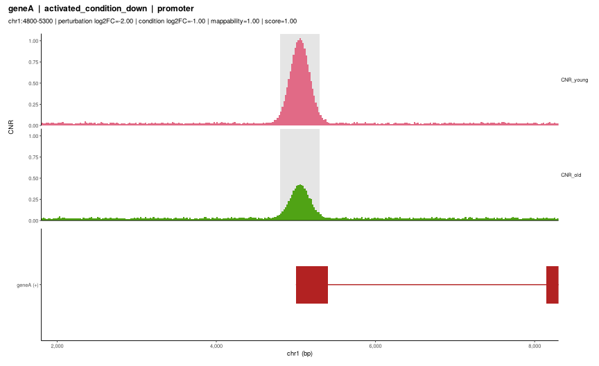
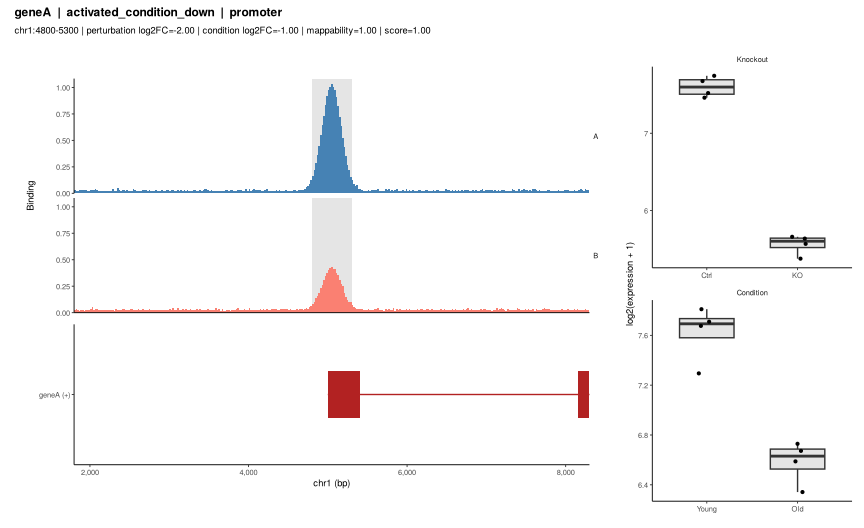

Choosing representative loci with LocusPick
================

- [Why](#why)
- [Quick start: one call](#quick-start-one-call)
- [Step by step](#step-by-step)
  - [1. Gene models and peaks](#1-gene-models-and-peaks)
  - [2. Gene groups from two
    contrasts](#2-gene-groups-from-two-contrasts)
  - [3. Candidates and quality
    control](#3-candidates-and-quality-control)
  - [4. Ranking](#4-ranking)
  - [5. Is the change specific?](#5-is-the-change-specific)
  - [6. Plots](#6-plots)
- [Using your own data](#using-your-own-data)
  - [Signal](#signal)
  - [Mappability](#mappability)
  - [Gene symbols](#gene-symbols)
- [A complete example](#a-complete-example)
- [Reporting](#reporting)

## Why

Most papers that integrate binding data (ChIP-seq, CUT&RUN, ATAC-seq)
with expression show a few “representative” genome browser tracks. These
are usually picked by eye, and the choice is rarely reported. That makes
the examples hard to reproduce, and it lets avoidable artifacts into
figures:

- a peak that the annotation assigns to a gene tens of kilobases away;
- a peak in a paralog cluster where reads cannot be placed uniquely;
- a peak in a gap of the signal track, so the browser shows nothing;
- gene symbols that differ between the annotation, the differential
  expression table and the gene models, so a gene silently drops out;
- a change in binding that looks specific to the example but is in fact
  genome-wide.

LocusPick turns the selection into an explicit pipeline. Every candidate
and every quality flag is kept in a table, and the ranking weights can
be stated in a figure legend.

## Quick start: one call

`locusPick()` takes the direct output of the usual tools (DESeq2, edgeR
or limma results; MACS2, SEACR, HOMER or DiffBind peaks; bigWig or BAM
files), checks the inputs, and returns ranked candidates:

``` r
library(LocusPick)
f <- function(x) system.file("extdata", x, package = "LocusPick")
de <- read.delim(f("toy_de.tsv"))

# stand-ins for a DESeq2 table and an edgeR table
ko_deseq2 <- data.frame(gene = de$gene, log2FoldChange = de$ko_lfc, padj = de$ko_padj)
age_edger <- data.frame(gene = de$gene, logFC = de$cond_lfc, FDR = de$cond_padj)

res <- locusPick(
    peaks        = f("toy_peaks.bed"),
    perturbation = ko_deseq2,  perturbationDirection = "KO/WT",
    condition    = age_edger,  conditionDirection    = "old/young",
    genes        = f("toy.gtf"),
    signal       = list(CNR_young = f("toy_A.bw"), CNR_old = f("toy_B.bw")),
    mappability  = f("toy_map.bw"))
#> == Reading inputs
#> toy_peaks.bed: bed, 8 peaks
#> x: DESeq2-style table | lfc = 'log2FoldChange', padj = 'padj', gene = 'gene' (symbol IDs) | 6 genes
#>   contrast (stated): KO/WT
#> x: edgeR-style table | lfc = 'logFC', padj = 'FDR', gene = 'gene' (symbol IDs) | 6 genes
#>   contrast (stated): old/young
#> == Checking inputs
#> [ok  ] chromosome naming: peaks / genes      UCSC / UCSC
#> [ok  ] peak chromosomes found in gene models 100%
#> [ok  ] peaks within 5,000 bp of a gene       100%
#> [warn] signal 'CNR_young': peaks with data   88%
#> [warn] signal 'CNR_old': peaks with data     88%
#> [ok  ] grouped genes found in gene models    100%
#>         Peaks without signal: check build/naming of the track, or gaps in its coverage.
#> == Building candidates
#>   ranking weights: CNR_young_mean = 1, abs_lfc_perturbation = 1, abs_lfc_condition = 1
res
#> LocusPick result
#>   contrasts: perturbation = KO/WT | condition = old/young 
#>   peaks: 8 | candidate peak-gene pairs: 6 | eligible: 4 
#>   weights: CNR_young_mean=1, abs_lfc_perturbation=1, abs_lfc_condition=1 
#> 
#>                     group peaks genes fail_gene_in_models fail_near_gene
#>  activated_condition_down     2     2                   0              0
#>    activated_condition_up     1     1                   0              0
#>  repressed_condition_down     2     1                   0              0
#>    repressed_condition_up     1     1                   0              0
#>  fail_mappable fail_has_signal eligible eligible_genes
#>              0               0        2              2
#>              0               0        1              1
#>              1               1        0              0
#>              0               0        1              1
#> 
#> Signal change (first vs second track):
#>                     group n frac_a_gt_b median_log2_a_over_b
#>  activated_condition_down 2       1.000                0.958
#>    activated_condition_up 1       1.000                0.233
#>  repressed_condition_down 1       1.000                0.536
#>    repressed_condition_up 1       1.000                0.622
#>    background (all peaks) 7       0.857                0.536
#> 
#> Top loci:
#>                     group  gene          peak_id   feature score
#>  activated_condition_down geneA   chr1:4800-5300  promoter   1.0
#>  activated_condition_down geneE chr1:47800-48200  promoter   0.5
#>    activated_condition_up geneC chr1:27000-27400 gene body   1.0
#>    repressed_condition_up geneB chr1:19800-20300  promoter   1.0
#> 
#> Note: some input checks were not ok; see $checks.
```

``` r
plot(res, "geneA")
```

<!-- -->

`reportLoci(res, "review.pdf")` writes every top locus to a PDF and the
full candidate table to a TSV. With real data you would pass
DESeq2/edgeR objects or files directly; see
`vignette("preparing-inputs", package = "LocusPick")` for every
supported format.

The rest of this vignette walks through the same steps one function at a
time, which gives full control over each.

## Step by step

``` r
ex <- locusPickExample()
```

The example is a synthetic 60 kb chromosome with six genes, eight peaks,
two signal tracks (`A` and `B`, think “young” and “old”) and a
mappability track.

### 1. Gene models and peaks

``` r
ex$genes                     # readGeneModels("genes.gtf")
#> locusGeneModels: 6 genes, 18 collapsed exons
ex$peaks                     # asPeaks("peaks.bed")
#> GRanges object with 8 ranges and 2 metadata columns:
#>       seqnames      ranges strand |        name          peak_id
#>          <Rle>   <IRanges>  <Rle> | <character>      <character>
#>   [1]     chr1   4800-5300      * |       peak1   chr1:4800-5300
#>   [2]     chr1 19800-20300      * |       peak2 chr1:19800-20300
#>   [3]     chr1 27000-27400      * |       peak3 chr1:27000-27400
#>   [4]     chr1 34600-35100      * |       peak4 chr1:34600-35100
#>   [5]     chr1 47800-48200      * |       peak5 chr1:47800-48200
#>   [6]     chr1 44000-44400      * |       peak6 chr1:44000-44400
#>   [7]     chr1 56600-57100      * |       peak7 chr1:56600-57100
#>   [8]     chr1 58500-58900      * |       peak8 chr1:58500-58900
#>   -------
#>   seqinfo: 1 sequence from an unspecified genome; no seqlengths
```

`readGeneModels()` accepts a GTF/GFF path or an imported `GRanges`.
`asPeaks()` accepts BED/narrowPeak files, data frames or `GRanges`.

### 2. Gene groups from two contrasts

Groups combine regulation by the factor (from a perturbation such as a
knockout) with the direction of change in a condition (such as aging).

``` r
de <- read.delim(system.file("extdata", "toy_de.tsv", package = "LocusPick"))
ko  <- deTable(de, gene = "gene", lfc = "ko_lfc",   padj = "ko_padj")
age <- deTable(de, gene = "gene", lfc = "cond_lfc", padj = "cond_padj")
groups <- defineGroups(ko, age, alpha = 0.05, perturbationType = "loss",
                       conditionName = "condition")
groups
#>    gene regulation condition_dir                    group lfc_perturbation
#> 1 geneA  activated          down activated_condition_down             -2.0
#> 5 geneE  activated          down activated_condition_down             -1.2
#> 3 geneC  activated            up   activated_condition_up             -1.0
#> 4 geneD  repressed          down repressed_condition_down              1.0
#> 2 geneB  repressed            up   repressed_condition_up              1.5
#>   padj_perturbation lfc_condition padj_condition
#> 1             1e-06          -1.0          1e-04
#> 5             1e-04          -0.7          1e-03
#> 3             1e-03           0.8          1e-02
#> 4             1e-04          -0.9          1e-03
#> 2             1e-05           1.2          1e-03
```

With `perturbationType = "loss"`, genes that go down in the knockout are
`activated` by the factor.

### 3. Candidates and quality control

``` r
cand <- buildCandidates(ex$peaks, ex$genes, groups,
                        signal = ex$signal, mappability = ex$mappability,
                        maxDist = 5000, minMappability = 0.8, minCoverage = 0.5)
qcSummary(cand)
#>                      group peaks genes fail_gene_in_models fail_near_gene
#> 1 activated_condition_down     2     2                   0              0
#> 2   activated_condition_up     1     1                   0              0
#> 3 repressed_condition_down     2     1                   0              0
#> 4   repressed_condition_up     1     1                   0              0
#>   fail_mappable fail_has_signal eligible eligible_genes
#> 1             0               0        2              2
#> 2             0               0        1              1
#> 3             1               1        0              0
#> 4             0               0        1              1
cand[, c("gene", "group", "peak_id", "feature", "A_mean", "B_mean",
         "mappability", "has_signal", "mappable", "eligible")]
#>    gene                    group          peak_id    feature    A_mean
#> 1 geneA activated_condition_down   chr1:4800-5300   promoter 0.6069934
#> 2 geneE activated_condition_down chr1:47800-48200   promoter 0.5003183
#> 3 geneC   activated_condition_up chr1:27000-27400  gene body 0.4346819
#> 4 geneD repressed_condition_down chr1:34600-35100   promoter 0.5488095
#> 5 geneD repressed_condition_down chr1:44000-44400 downstream        NA
#> 6 geneB   repressed_condition_up chr1:19800-20300   promoter 0.4915202
#>      B_mean mappability has_signal mappable eligible
#> 1 0.2596276         1.0       TRUE     TRUE     TRUE
#> 2 0.2995152         1.0       TRUE     TRUE     TRUE
#> 3 0.3684506         1.0       TRUE     TRUE     TRUE
#> 4 0.3754763         0.3       TRUE    FALSE    FALSE
#> 5        NA         1.0      FALSE     TRUE    FALSE
#> 6 0.3159235         1.0       TRUE     TRUE     TRUE
```

Both *geneD* peaks fail, for different reasons: the promoter peak lies
in a low-mappability region, and the downstream peak sits in a gap of
the signal tracks. Both stay in the table, flagged, and *geneD*’s group
has no eligible example. That is itself worth knowing before choosing a
figure panel.

If your peaks already carry a gene assignment (for example from HOMER or
an enhancer-target database), pass it with `geneCol`. LocusPick then
checks each assignment against your gene models instead of trusting it:

``` r
pk <- ex$peaks
pk$gene <- c("geneA", "geneB", "geneA", "geneD", "geneE", "geneE", "geneF", "geneF")
chk <- checkAssignment(pk, ex$genes, geneCol = "gene")
chk[!chk$near_gene, ]
#>            peak_id  gene gene_in_models distance near_gene
#> 3 chr1:27000-27400 geneA           TRUE    14999     FALSE
```

### 4. Ranking

`rankLoci()` scores eligible candidates within each group as a weighted
mean of percentile ranks. Positive weights reward high values and
negative weights reward low ones. A candidate missing any weighted value
is not scored, so a locus can never rank highly on a subset of the
criteria.

``` r
cand$loss <- cand$A_mean - cand$B_mean
ranked <- rankLoci(cand, c(A_mean = 1, loss = 1,
                           abs_lfc_perturbation = 1, abs_lfc_condition = 1))
top <- topLoci(ranked, n = 3)
top[, c("group", "gene", "peak_id", "score", "rank")]
#>                      group  gene          peak_id score rank
#> 1 activated_condition_down geneA   chr1:4800-5300   1.0    1
#> 2 activated_condition_down geneE chr1:47800-48200   0.5    2
#> 3   activated_condition_up geneC chr1:27000-27400   1.0    1
#> 4   repressed_condition_up geneB chr1:19800-20300   1.0    1
```

Different groups can use different criteria by passing a named list of
weight vectors.

### 5. Is the change specific?

Before claiming that loss of binding at an example explains its
expression change, check whether the loss is specific to that group or
seen at all peaks:

``` r
signalShift(cand, "A_mean", "B_mean",
            background = signalAtPeaks(ex$peaks, ex$signal))
#>                      group n frac_a_gt_b median_log2_a_over_b
#> 1 activated_condition_down 2   1.0000000            0.9578369
#> 2   activated_condition_up 1   1.0000000            0.2326687
#> 3 repressed_condition_down 1   1.0000000            0.5357144
#> 4   repressed_condition_up 1   1.0000000            0.6217747
#> 5   background (all peaks) 7   0.8571429            0.5357144
```

If every group and the background show a similar shift, a track showing
reduced binding at the example is consistent with the hypothesis but not
specific to it. That difference should be reflected in the figure
legend.

### 6. Plots

``` r
plotLocus(top[1, ], ex$signal, ex$genes,
          trackGroups = list(Binding = c("A", "B")),
          colors = c(A = "steelblue", B = "salmon"),
          expression = ex$expression)
```

<!-- -->

Tracks in one `trackGroups` panel share a y-axis, so conditions are
directly comparable; different panels (for example CUT&RUN and ATAC) get
their own scales. For figure panels use `annotate = FALSE`, and set
`yLimits` so several loci share the same axes.

`reportLoci()` writes one page per locus, plus the full candidate table,
for review:

``` r
reportLoci(top, "candidates.pdf", signal = ex$signal, genes = ex$genes,
           trackGroups = list(Binding = c("A", "B")),
           expression = ex$expression, candidates = ranked)
```

## Using your own data

For step-by-step options to produce each input (bigWigs from BAM or
bedGraph, consensus peaks, gene models, DE tables from
DESeq2/edgeR/limma, expression insets, mappability) and to check them
with `checkInputs()`, see
`vignette("preparing-inputs", package = "LocusPick")`.

### Signal

Any of these can be used as a track:

``` r
signal <- list(
    CNR_young = bigWigSource("cnr_young.bw"),          # bigWig file or URL
    CNR_old   = "cnr_old.bw",                          # a path also works
    ATAC      = rangesSource(rtracklayer::import("atac.bedGraph")),
    H3K27ac   = chromDictSource(readRDS("h3k27ac.rds"), binSize = 20),
    custom    = functionSource(function(chr, start, end) myFetcher(chr, start, end))
)
```

### Mappability

Umap multi-read mappability (Karimzadeh et al. 2018) gives, for each
base, the fraction of overlapping k-mers that map uniquely. The Umap
authors distribute it as a bedGraph; the bundled script converts it to
an indexed bigWig once:

``` r
system.file("scripts", "make_umap_bw.sh", package = "LocusPick")
# bash make_umap_bw.sh 50      # k = read length closest to your data
```

Choose `k` close to your read length; shorter k is more conservative.

### Gene symbols

When sources come from different annotation releases, harmonize symbols
before building groups and gene models:

``` r
h <- function(s) harmonizeSymbols(s, org.Mm.eg.db::org.Mm.eg.db)
genes <- readGeneModels("mm10.gtf", harmonize = h)
ko$gene  <- h(ko$gene)
age$gene <- h(age$gene)
```

## A complete example

A CUT&RUN analysis of a liver transcription factor in young and old
mice, with a hepatocyte knockout as the perturbation, starting from
pipeline outputs:

``` r
library(org.Mm.eg.db)

# signal and peaks from an nf-core/cutandrun results folder
out <- findPipelineOutputs("cutandrun_results/")
cnr <- signalFromFiles(out, c(young = "^Y", old = "^O"))     # replicates averaged
peaks <- out$file[out$type == "peaks" & out$caller == "seacr" &
                  grepl("^Y", out$sample) & !out$control]

res <- locusPick(
    peaks        = peaks,                       # replicates -> consensus (>= 2)
    blacklist    = "mm10-blacklist.v2.bed.gz",
    perturbation = ko_results,                  # DESeq2 results: KO vs WT
    condition    = "old_vs_young_edgeR.csv",    conditionDirection = "old/young",
    genes        = "gencode.vM25.annotation.gtf",
    orgDb        = org.Mm.eg.db,                # Ensembl IDs, outdated symbols
    signal       = list(CNR_young = cnr$young, CNR_old = cnr$old,
                        ATAC_young = c("atac_y1.bw", "atac_y2.bw"),
                        ATAC_old   = c("atac_o1.bw", "atac_o2.bw")),
    mappability  = "k50.Umap.MultiTrackMappability.bw",
    expression   = list(expressionFrom(dds_ko,  "genotype", panel = "Knockout"),
                        expressionFrom(dds_age, "age",      panel = "Aging")),
    conditionName = "age")

res$checks; res$qc; res$shift
reportLoci(res, "review.pdf")
```

## Reporting

A sentence like the following lets readers reproduce the choice:

> Representative loci were selected with LocusPick (v0.2.0). Peaks were
> assigned to the nearest gene within 5 kb; loci with mean Umap k50
> mappability \< 0.8, \< 50% signal coverage, or an assignment
> inconsistent with the gene models were excluded. Remaining loci were
> ranked within each group by the mean percentile rank of young CUT&RUN
> signal, loss of signal with age, and the absolute knockout and age
> log2 fold changes. The top-ranked locus per group is shown; all
> candidates are listed in Supplementary Table X.

``` r
sessionInfo()
#> R version 4.3.3 (2024-02-29)
#> Platform: x86_64-pc-linux-gnu (64-bit)
#> Running under: Ubuntu 24.04.5 LTS
#> 
#> Matrix products: default
#> BLAS:   /usr/lib/x86_64-linux-gnu/blas/libblas.so.3.12.0 
#> LAPACK: /usr/lib/x86_64-linux-gnu/lapack/liblapack.so.3.12.0
#> 
#> locale:
#> [1] C
#> 
#> time zone: America/Los_Angeles
#> tzcode source: system (glibc)
#> 
#> attached base packages:
#> [1] stats     graphics  grDevices utils     datasets  methods   base     
#> 
#> other attached packages:
#> [1] LocusPick_0.2.0
#> 
#> loaded via a namespace (and not attached):
#>  [1] utf8_1.2.4                  generics_0.1.3             
#>  [3] SparseArray_1.2.4           bitops_1.0-7               
#>  [5] lattice_0.22-5              digest_0.6.34              
#>  [7] magrittr_2.0.3              evaluate_0.23              
#>  [9] grid_4.3.3                  fastmap_1.1.1              
#> [11] Matrix_1.6-5                restfulr_0.0.15            
#> [13] GenomeInfoDb_1.38.6         fansi_1.0.5                
#> [15] scales_1.3.0                XML_3.99-0.16.1            
#> [17] Biostrings_2.70.2           codetools_0.2-19           
#> [19] abind_1.4-5                 cli_3.6.2                  
#> [21] rlang_1.1.3                 crayon_1.5.2               
#> [23] XVector_0.42.0              Biobase_2.62.0             
#> [25] munsell_0.5.0               withr_2.5.0                
#> [27] DelayedArray_0.28.0         yaml_2.3.8                 
#> [29] S4Arrays_1.2.0              tools_4.3.3                
#> [31] parallel_4.3.3              BiocParallel_1.36.0        
#> [33] dplyr_1.1.4                 colorspace_2.1-0           
#> [35] ggplot2_3.4.4               GenomeInfoDbData_1.2.11    
#> [37] Rsamtools_2.18.0            SummarizedExperiment_1.32.0
#> [39] BiocGenerics_0.48.1         vctrs_0.6.5                
#> [41] R6_2.5.1                    matrixStats_1.2.0          
#> [43] BiocIO_1.12.0               stats4_4.3.3               
#> [45] lifecycle_1.0.4             rtracklayer_1.62.0         
#> [47] zlibbioc_1.48.0             S4Vectors_0.40.2           
#> [49] IRanges_2.36.0              pkgconfig_2.0.3            
#> [51] pillar_1.9.0                gtable_0.3.4               
#> [53] glue_1.7.0                  highr_0.10                 
#> [55] xfun_0.41                   tibble_3.2.1               
#> [57] GenomicRanges_1.54.1        GenomicAlignments_1.38.2   
#> [59] tidyselect_1.2.0            MatrixGenerics_1.14.0      
#> [61] knitr_1.45                  farver_2.1.1               
#> [63] rjson_0.2.21                patchwork_1.2.0            
#> [65] htmltools_0.5.7             labeling_0.4.3             
#> [67] rmarkdown_2.25              compiler_4.3.3             
#> [69] RCurl_1.98-1.14
```
