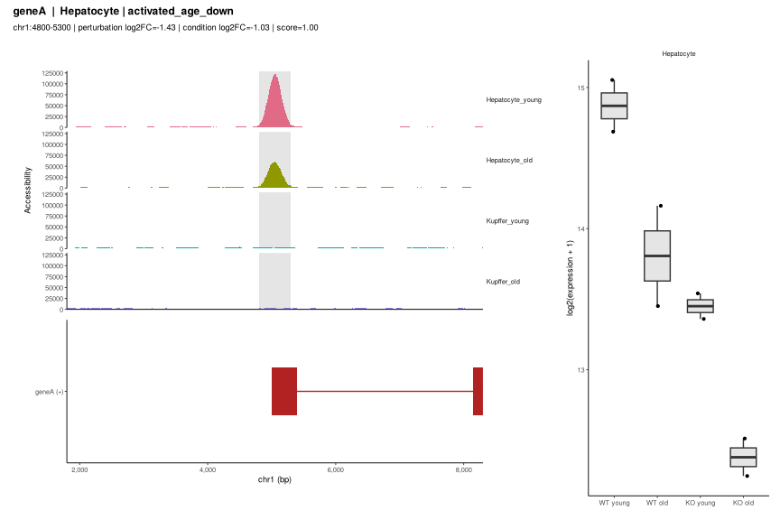

LocusPick for single-cell multiome and scRNA + scATAC data
================

- [Example data](#example-data)
- [One call](#one-call)
- [With Seurat + Signac objects](#with-seurat--signac-objects)
- [Other inputs](#other-inputs)
- [Step by step](#step-by-step)
  - [Pseudobulk differential
    expression](#pseudobulk-differential-expression)
  - [Accessibility tracks](#accessibility-tracks)
  - [Peak-gene links](#peak-gene-links)
- [Things to watch](#things-to-watch)

With single-cell data, every step of the LocusPick workflow gains a
**cell-type** dimension:

| Step                    | Bulk                  | Single cell                                                                             |
|-------------------------|-----------------------|-----------------------------------------------------------------------------------------|
| Differential expression | DESeq2/edgeR results  | **pseudobulk** DE per cell type (`pseudobulkDE()`)                                      |
| Signal tracks           | bigWigs per condition | accessibility per cell type × condition, from the fragments file (`scSignal()`)         |
| Peak → gene             | nearest gene          | **peak-gene links** from multiome data when available, else nearest gene                |
| Groups and ranking      | per group             | per cell type × group                                                                   |
| Plots                   | tracks + expression   | all cell types’ tracks (shared y-axis) + pseudobulk expression of the locus’s cell type |

`scLocusPick()` runs all of it. It accepts:

- **multiome** data (RNA and ATAC from the same cells): one Seurat
  object with an RNA assay and a Signac `ChromatinAssay`, a Cell Ranger
  ARC output folder, or matrices;
- **unpaired** scRNA-seq + scATAC-seq of the same samples: two objects
  (or folders) whose metadata share cell-type, sample and condition
  columns.

Supported inputs: Seurat (with Signac), Bioconductor
`SingleCellExperiment`, Cell Ranger / Cell Ranger ATAC / Cell Ranger ARC
folders (`read10x()`), and plain count matrices with a metadata table.

## Example data

``` r
library(LocusPick)
sc <- locusPickSingleCellExample()
table(sc$meta$cell_type, paste(sc$meta$genotype, sc$meta$age))
#>             
#>              KO old KO young WT old WT young
#>   Hepatocyte     50       50     50       50
#>   Kupffer        50       50     50       50
```

The synthetic data have 8 samples (WT/KO × young/old, 2 replicates each)
and two cell types. In hepatocytes, *geneA* is activated by the factor
(lower in KO) and falls with age, and accessibility at its promoter
drops with age. Kupffer cells show no changes but have their own open
site near *geneF*.

## One call

``` r
res <- scLocusPick(
    sc$rna, atac = NULL,                      # matrices here; see below for objects
    cellType = "cell_type", sample = "sample",
    perturbation = c("genotype", "KO", "WT"), # test / reference
    condition    = c("age", "old", "young"),
    genes = sc$genes, peaks = sc$peaks, links = sc$links,
    fragments = sc$fragments, meta = sc$meta, atacMeta = sc$meta)
#> == Reading inputs
#> == Pseudobulk DE (DESeq2): genotype KO vs WT
#> Hepatocyte: 4 vs 4 samples, ~age + genotype; 4 of 66 genes padj < 0.05
#> Kupffer: 4 vs 4 samples, ~age + genotype; 0 of 66 genes padj < 0.05
#> == Pseudobulk DE (DESeq2): age old vs young
#> Hepatocyte: 4 vs 4 samples, ~genotype + age; 4 of 66 genes padj < 0.05
#> Kupffer: 4 vs 4 samples, ~genotype + age; 0 of 66 genes padj < 0.05
#> == Accessibility tracks
#> scSignal: 4 tracks (Hepatocyte_old: 100 cells; Kupffer_old: 100 cells;
#>   Hepatocyte_young: 100 cells; Kupffer_young: 100 cells)
#> == Building candidates per cell type
#>   Hepatocyte: 5 candidate peak-gene pairs, 5 eligible
#>   Kupffer: no candidates
#> ranking weights: young_mean = 1, abs_lfc_perturbation = 1, abs_lfc_condition
#>     = 1, link_score = 1
res
#> LocusPick result
#>   perturbation: genotype KO vs WT (pseudobulk) 
#>   condition:    age old vs young (pseudobulk) 
#>   cell types: Hepatocyte 
#>   peaks: 8 | candidate peak-gene pairs: 5 | eligible: 5 
#> weights: young_mean=1, abs_lfc_perturbation=1, abs_lfc_condition=1,
#>     link_score=1
#> 
#>                            group peaks genes fail_gene_in_models fail_near_gene
#>  Hepatocyte | activated_age_down     3     2                   0              0
#>    Hepatocyte | activated_age_up     1     1                   0              0
#>    Hepatocyte | repressed_age_up     1     1                   0              0
#>  fail_mappable fail_has_signal eligible eligible_genes
#>              0               0        3              2
#>              0               0        1              1
#>              0               0        1              1
#> 
#> Signal change (first vs second track):
#>                                group n frac_a_gt_b median_log2_a_over_b
#>      Hepatocyte | activated_age_down 3       0.333               -0.084
#>        Hepatocyte | activated_age_up 1       0.000               -0.084
#>        Hepatocyte | repressed_age_up 1       1.000                0.511
#>  Hepatocyte | background (all peaks) 8       0.250               -0.142
#>  p_vs_zero shift_vs_background p_vs_background
#>      1.000              0.0581               1
#>         NA              0.0581              NA
#>         NA              0.6534              NA
#>      0.742                  NA              NA
#> 
#> Top loci:
#>                            group  gene          peak_id score
#>  Hepatocyte | activated_age_down geneA   chr1:4800-5300  1.00
#>  Hepatocyte | activated_age_down geneE chr1:47800-48200  0.45
#>    Hepatocyte | activated_age_up geneC chr1:27000-27400  1.00
#>    Hepatocyte | repressed_age_up geneB chr1:19800-20300  1.00
```

``` r
plot(res, "geneA")
```

<!-- -->

The tracks show every cell type and condition on one shared y-axis, so
the cell-type specificity of a site is visible. The inset shows
pseudobulk expression (CPM) in the locus’s cell type for every genotype
× age group. `reportLoci(res, "review.pdf")` writes all top loci and the
candidate table.

Kupffer cells have no candidates here because no gene is differentially
expressed in them. That is reported, not hidden.

## With Seurat + Signac objects

For a multiome object, everything is taken from the object: RNA counts
from the default assay (or `RNA` if the default holds peaks), peaks,
fragment files and the barcode mapping from the chromatin assay, and
peak-gene links from `Links()` if you ran `Signac::LinkPeaks()`.

``` r
so <- locusPickSingleCellExample(seurat = TRUE)$object
so
#> An object of class Seurat 
#> 74 features across 400 samples within 2 assays 
#> Active assay: RNA (66 features, 0 variable features)
#>  2 layers present: counts, data
#>  1 other assay present: ATAC
```

``` r
res2 <- scLocusPick(so, cellType = "cell_type", sample = "sample",
                    perturbation = c("genotype", "KO", "WT"),
                    condition = c("age", "old", "young"),
                    genes = sc$genes)
#> == Reading inputs
#>   Using 5 peak-gene links from the 'ATAC' assay.
#> == Pseudobulk DE (DESeq2): genotype KO vs WT
#> Hepatocyte: 4 vs 4 samples, ~age + genotype; 4 of 66 genes padj < 0.05
#> Kupffer: 4 vs 4 samples, ~age + genotype; 0 of 66 genes padj < 0.05
#> == Pseudobulk DE (DESeq2): age old vs young
#> Hepatocyte: 4 vs 4 samples, ~genotype + age; 4 of 66 genes padj < 0.05
#> Kupffer: 4 vs 4 samples, ~genotype + age; 0 of 66 genes padj < 0.05
#> == Accessibility tracks
#> scSignal: CPM using per-cell 'nCount_ATAC'
#> scSignal: 4 tracks (Hepatocyte_old: 100 cells; Kupffer_old: 100 cells;
#>   Hepatocyte_young: 100 cells; Kupffer_young: 100 cells)
#> == Building candidates per cell type
#>   Hepatocyte: 5 candidate peak-gene pairs, 5 eligible
#>   Kupffer: no candidates
#> ranking weights: young_mean = 1, abs_lfc_perturbation = 1, abs_lfc_condition
#>     = 1, link_score = 1
res2$top[, c("group", "gene", "peak_id", "link_score", "score")]
#>                             group  gene          peak_id link_score score
#> 1 Hepatocyte | activated_age_down geneA   chr1:4800-5300       0.62  1.00
#> 2 Hepatocyte | activated_age_down geneE chr1:47800-48200       0.30  0.45
#> 3   Hepatocyte | activated_age_up geneC chr1:27000-27400       0.35  1.00
#> 4   Hepatocyte | repressed_age_up geneB chr1:19800-20300       0.48  1.00
```

For **unpaired** data, pass the two objects:

``` r
res <- scLocusPick(rna_obj, atac = atac_obj,
                   cellType = "cell_type", sample = "sample",
                   perturbation = c("genotype", "KO", "WT"),
                   condition = c("age", "old", "young"),
                   genes = "gencode.vM25.annotation.gtf",
                   orgDb = org.Mm.eg.db::org.Mm.eg.db)
```

Without peak-gene links (they need RNA and ATAC from the same cells),
peaks are assigned to the nearest gene. Cell-type labels must use the
same names in both objects; label transfer between modalities
(e.g. Seurat’s `TransferData()`) is the usual way to get there.

## Other inputs

`SingleCellExperiment` objects work like Seurat objects, using the
`counts` assay by default; give the fragments file and, if the ATAC data
are a separate object, its metadata:

``` r
res <- scLocusPick(sce_rna, atac = NULL, cellType = "celltype", sample = "donor",
                   condition = c("treatment", "drug", "vehicle"),
                   genes = "genes.gtf", peaks = "peaks.bed",
                   fragments = "fragments.tsv.gz", atacMeta = colData(sce_atac))
```

Cell Ranger output folders are read with `read10x()`. Cell Ranger does
not know your cell types or samples, so add a metadata table with one
row per barcode (from your clustering):

``` r
arc <- read10x("sample1/outs")                  # Cell Ranger ARC (multiome)
arc
res <- scLocusPick(arc, cellType = "cell_type", sample = "sample",
                   condition = c("age", "old", "young"),
                   genes = "genes.gtf", meta = my_annotations)
```

For several samples, aggregate them first (`cellranger-arc aggr`) or
merge them into one object; `fragmentSource()` also accepts several
fragment files with one barcode list per file.

## Step by step

### Pseudobulk differential expression

``` r
pb <- pseudobulk(sc$rna, sample = "sample", cellType = "cell_type", meta = sc$meta)
pb
#> LocusPickPseudobulk: 66 features x 16 pseudobulks
#> cell_type
#> Hepatocyte    Kupffer 
#>          8          8
de <- pseudobulkDE(pb, contrast = c("genotype", "KO", "WT"), covariates = "age")
#> Hepatocyte: 4 vs 4 samples, ~age + genotype; 4 of 66 genes padj < 0.05
#> Kupffer: 4 vs 4 samples, ~age + genotype; 0 of 66 genes padj < 0.05
de
#> Pseudobulk DE (KO vs WT) for 2 cell type(s):
#>   Hepatocyte: 66 genes, 4 with padj < 0.05
#>   Kupffer: 66 genes, 0 with padj < 0.05
head(de$Hepatocyte, 4)
#>    gene        lfc         padj
#> 1 geneB  1.1849132 2.357442e-13
#> 2 geneA -1.4304932 3.788860e-12
#> 3 geneC -0.9350889 2.053594e-06
#> 4 geneE -0.7654461 3.038878e-04
```

`pseudobulkDE()` uses the object’s default assay unless `assay` is
given, and can also take the object directly. Each result is a normal
LocusPick DE table, so it plugs into `defineGroups()`. Your own DE
results can be used instead: pass a table (used for every cell type) or
a named list of tables per cell type as `perturbation` or `condition`.

### Accessibility tracks

``` r
tracks <- scSignal(NULL, groupBy = c("cell_type", "age"),
                   fragments = sc$fragments, meta = sc$meta)
#> scSignal: 4 tracks (Hepatocyte_old: 100 cells; Kupffer_old: 100 cells;
#>   Hepatocyte_young: 100 cells; Kupffer_young: 100 cells)
signalAtPeaks(sc$peaks[c(1, 7)], tracks)[, c("peak_id", "Hepatocyte_young_mean",
                                             "Hepatocyte_old_mean", "Kupffer_young_mean")]
#>            peak_id Hepatocyte_young_mean Hepatocyte_old_mean Kupffer_young_mean
#> 1   chr1:4800-5300              61396.71            31323.54           2922.047
#> 2 chr1:56600-57100              10816.39            13073.91         118662.448
```

Coverage is counted from the fragments of each group’s cells and scaled
per million fragments. When the metadata hold a per-cell fragment count
(`atac_fragments`, `passed_filters`) or in-peak count (`nCount_ATAC`),
it is used as the total; otherwise the fragments file is read once to
count it.

### Peak-gene links

Links are used as the peak-gene assignment when available. They can come
from `Signac::Links()` or any table with a `peak` (`"chr-start-end"`)
and `gene` column:

``` r
cand <- buildCandidates(sc$peaks, sc$genes, groups = NULL, links = sc$links)
cand[, c("gene", "peak_id", "link_score", "distance", "near_gene")]
#>    gene          peak_id link_score distance near_gene
#> 1 geneA chr1:27000-27400       0.12    14999      TRUE
#> 2 geneA   chr1:4800-5300       0.62        0      TRUE
#> 3 geneB chr1:19800-20300       0.48        0      TRUE
#> 4 geneC chr1:27000-27400       0.35        0      TRUE
#> 5 geneE chr1:47800-48200       0.30        0      TRUE
```

Links longer than `maxLinkDist` (default 500 kb) are flagged.

## Things to watch

- **Use pseudobulk DE.** Cell-level tests (e.g. Seurat `FindMarkers()`)
  treat every cell as a replicate and give inflated p-values. `readDE()`
  reads their output but warns. Pseudobulk DE needs at least two
  biological samples per condition (`minSamples`); cell types without
  them are skipped with a message.
- **Adjust for other factors.** In a two-factor design, each contrast is
  adjusted for the other automatically. When testing only one, list the
  other sample-level factors in `covariates`. In the example, testing
  age alone without adjusting for genotype finds no significant genes.
- **Use raw counts.** Pseudobulk sums raw counts. The `SCT` assay holds
  corrected counts; prefer the `RNA` assay (LocusPick reports which one
  it uses).
- **Cell numbers.** Pseudobulks and tracks from fewer than `minCells`
  cells are dropped. Rare cell types give noisy tracks.
- **Global shifts.** As in bulk data, check `res$shift`: if
  accessibility falls with age at most peaks in a cell type, a track
  showing the same fall at an example is not specific to it.
